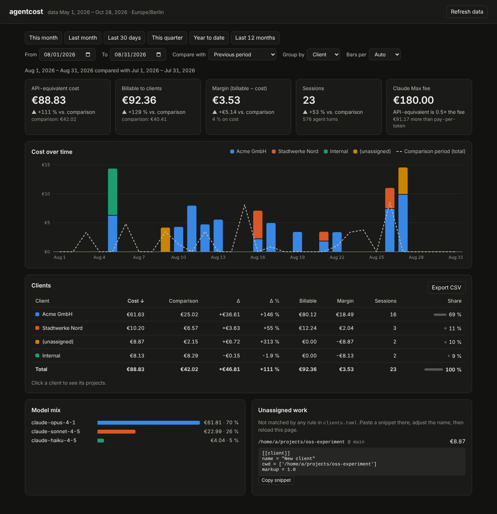

# agentcost

**What did AI agent work cost per client — and what can I bill?**

agentcost reads the metadata of your Claude Code sessions (time, folder, git
branch, model, token counts), assigns each session to a client by simple rules,
prices it, applies your markup, and shows the result in a local web view or as
a table / CSV.

- **Private:** never reads prompts, answers or code; no AI calls; runs on your PC.
- **Local and cloud sessions:** Claude Code on your PC, plus cloud sessions
  (Claude Code on the web) via your own small collector.
- **Monthly report per client:** printable page / PDF with the amount to bill,
  by project, model, week and session.
- **History kept:** a local database keeps everything after Claude Code deletes
  its logs.
- **No dependencies:** Python 3.11+ only.



## Start here

**→ [docs/getting-started.md](docs/getting-started.md)** — all steps, from
installation to your first per-client numbers.

The short version (PowerShell, inside the agentcost folder):

```powershell
python -m agentcost doctor          # what is found
python -m agentcost init            # create clients.toml from your folders
python -m agentcost serve --open    # web view on http://127.0.0.1:8765/
```

Try it with demo data first:

```powershell
python gen_sample.py
python -m agentcost serve --config clients.example.toml --logs sample_logs --db sample.db --open
```

## Guides

| Guide | For |
|---|---|
| [Getting started](docs/getting-started.md) | installation, first run, everyday use, troubleshooting |
| [Clients and rules](docs/clients.md) | how work is assigned to clients, folder layouts, patterns |
| [Cloud sessions](docs/cloud.md) | counting Claude Code on the web via Cloudflare or your own server |

## Commands

All commands start with `python -m agentcost` (or `agentcost` after
`pip install -e .`). `--config` defaults to `clients.toml` in the current folder.

| Command | What it does |
|---|---|
| `init` | create `clients.toml` with one client per project folder found (`--print`, `--force`) |
| `doctor` | show log folders, models (with price source), clients and unassigned folders |
| `serve` | web view on `127.0.0.1` (`--port`, `--open`) |
| `report` | per-client table in the terminal (`--month 2026-10`, `--csv file.csv`) |
| `monthly` | printable monthly report per client (`--month`, `--client`, `--internal`); also via **Report ↗** in the web view |
| `ingest` | only copy new log entries into the local database |
| `sync` | download cloud-session data from your collector (automatic once set up) |
| `cloud-setup` | print the setup script for your cloud environment |
| `tokens` | create an ingest + read token pair for the collector |
| `collector` | run a self-hosted collector (alternative to the Cloudflare Worker) |

Every command first reads new log entries (and cloud data, if set up), so the
numbers are always current. All take `--logs DIR` and `--db FILE`.

## Configuration

`clients.toml` (created by `init`, ignored by git):

- `[[client]]` rules: `name`, `cwd` / `branch` patterns, `markup` — see
  [docs/clients.md](docs/clients.md).
- `currency_symbol`, `currency_rate` (one fixed USD rate), `timezone`.
- Optional `[subscription]` (`name`, `monthly_fee`, `since`): your flat fee is
  shown next to the API-equivalent cost.
- Optional `[prices."model-id"]`: prices for Claude models are built in
  (`agentcost/prices.toml`, API list prices); add others or override here.

On a subscription plan the amounts are what the same usage would cost on the
API — a fair basis for billing, not your actual spend.

## Development

```powershell
pip install pytest
python -m pytest
```

The Cloudflare Worker has its own tests: `cd cloud/worker; node --test test/worker.test.mjs`.
Roadmap: [PLAN.md](PLAN.md).
